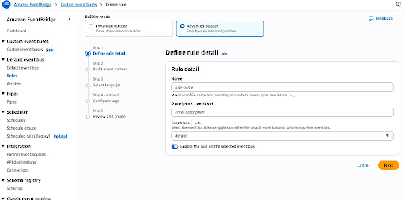
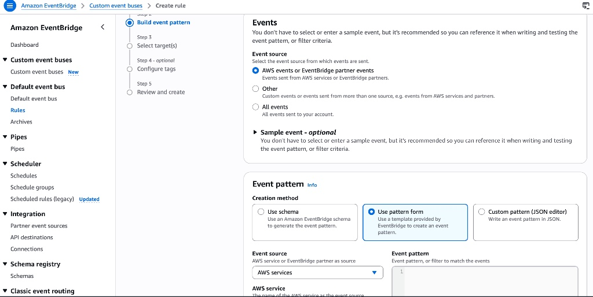
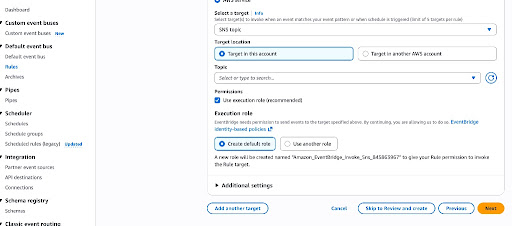
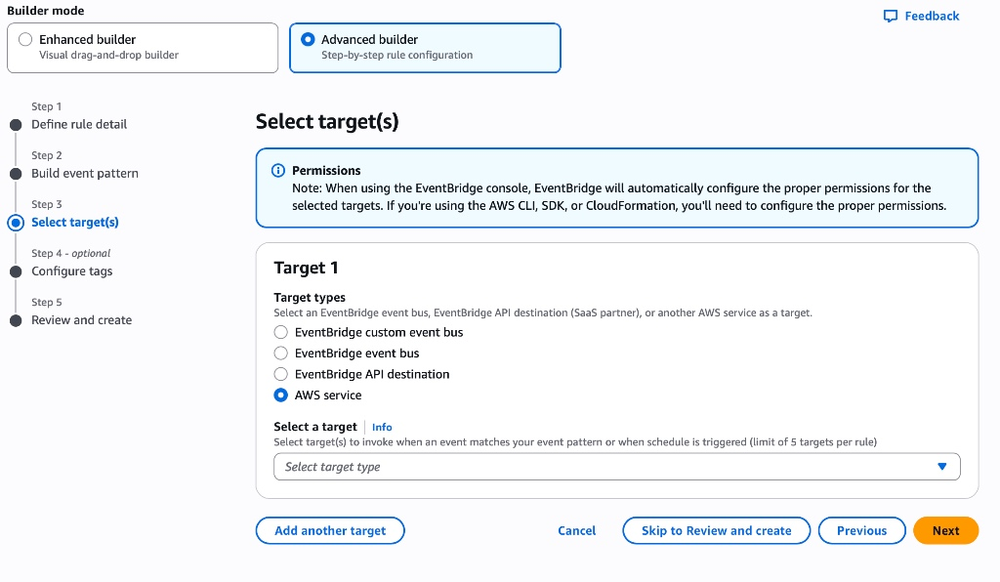
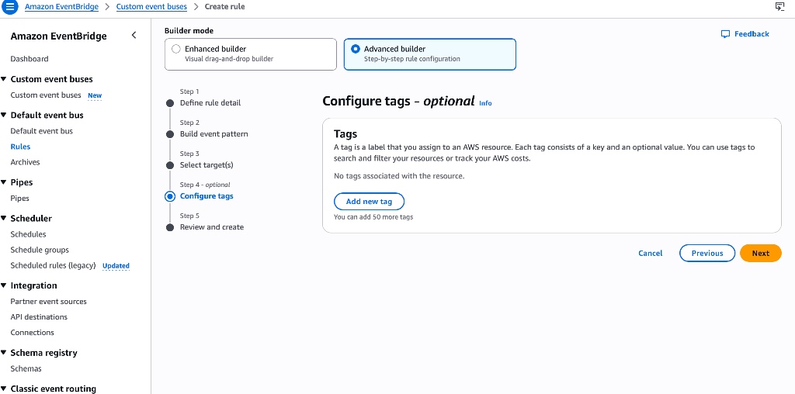

# AWS Cloud Threat Monitoring and Alerting Pipeline

## Project Overview

This project demonstrates an AWS cloud security monitoring and alerting pipeline designed to detect, prioritize, and communicate high-severity security findings.

The lab combines identity security, network segmentation, centralized audit logging, intelligent threat detection, event-driven filtering, analyst notification, and cost monitoring.

Amazon GuardDuty findings with severity values of 7 or higher are filtered through Amazon EventBridge and forwarded to an Amazon SNS topic for email notification. The resulting alert enables a security analyst to begin investigation and determine the appropriate response.

This project was created in a personal AWS lab for cybersecurity training and portfolio development.

---

## Architecture

```text
AWS Account and Resource Activity
              |
       +------+------+
       |             |
       v             v
AWS CloudTrail   Amazon GuardDuty
       |             |
       v             v
   Amazon S3    Security Finding
                     |
                     v
              Amazon EventBridge
              Severity Filter >= 7
                     |
                     v
                 Amazon SNS
                     |
                     v
          Security Analyst Email
                     |
                     v
          Manual Investigation and
             Response Decision
```

CloudTrail delivers configured management-event logs to Amazon S3 for audit and investigation purposes. GuardDuty findings are published separately to EventBridge for filtering and routing.

---

## Project Objectives

- Secure administrative access to the AWS lab account
- Avoid using the AWS root account for routine activity
- Establish a segmented virtual network
- Record AWS management activity for audit and investigation
- Enable continuous cloud threat detection
- Prioritize high-severity GuardDuty findings
- Deliver prioritized findings to an analyst through email
- Document a repeatable investigation and escalation process
- Monitor unexpected cloud-service charges

---

## AWS Services Used

- AWS Identity and Access Management
- Amazon Virtual Private Cloud
- AWS CloudTrail
- Amazon Simple Storage Service
- Amazon GuardDuty
- Amazon EventBridge
- Amazon Simple Notification Service
- AWS Budgets

---

## Implementation Phases

### Phase 1: Identity and Account Security

- Enabled multi-factor authentication for the AWS root account
- Avoided using the root account for routine administrative work
- Created the `admin-dev` identity for lab administration
- Used identity-based permissions for AWS service configuration
- Created a $0.01 AWS Budget alert for early cost notification

### IAM Permission Verification


### Phase 2: Network Security

- Created a custom VPC using the `10.0.0.0/16` CIDR range
- Configured public and private subnets
- Applied network security controls to regulate permitted traffic
- Maintained the environment as an isolated educational lab

### Phase 3: Audit Logging

- Created the `cyber-lab-main-trail` CloudTrail trail
- Configured multi-region management-event logging
- Delivered audit logs to an Amazon S3 bucket
- Centralized AWS management-event records for investigation and compliance support

### Phase 4: Threat Detection

- Enabled Amazon GuardDuty
- Enabled selected GuardDuty protection features
- Reviewed generated security findings
- Evaluated finding severity, affected resources, and recommended response actions



### Phase 5: Event Filtering and Alerting

- Created the `cyber-lab-guardduty-high-severity` EventBridge rule
#### Custom JSON Filtering Pattern

- Used the default EventBridge event bus
- Filtered GuardDuty findings with severity values of 7 or higher
- Routed matching events to the `cyber-lab-alert-topic` SNS topic
#### SNS Target & IAM Execution Role Binding

- Confirmed an email subscription for analyst notification

<details>
<summary>🔍 Click to view additional EventBridge configuration screens</summary>

### Target Selection Workflow


### Final Review & Tags


</details>

### Phase 6: Investigation and Response

- Reviewed the GuardDuty finding details
- Examined the finding type, severity, affected resource, and supporting evidence
- Used available CloudTrail records to review relevant AWS activity
- Documented the investigation and recommended response
- Maintained human review before taking containment or remediation actions

---

## Security Controls Demonstrated

- Root-account MFA
- Separation of root and routine administrative activity
- Identity and access management
- Network segmentation
- Management-event logging
- Centralized audit-log storage
- Continuous cloud threat detection
- Severity-based alert prioritization
- Event-driven security notification
- Human review and investigation
- Cost-monitoring alerts

---

## Repository Contents

### Documentation

- Project overview
- Security-control summary
- Incident-investigation workflow

### Configurations

- Sanitized EventBridge event pattern for high-severity GuardDuty findings

### Findings

- Sanitized sample-finding analysis
- Analyst investigation notes
- Recommended response actions

### Artifacts

- AWS security-monitoring architecture diagram
- Sanitized implementation screenshots

---

## Skills Demonstrated

- AWS Cloud Security
- Cloud Threat Detection
- Security Monitoring
- Identity and Access Management
- Audit Logging
- Event-Driven Security Automation
- Alert Prioritization
- Incident Investigation
- Security Documentation
- Network Segmentation
- Cost Governance

---

## Project Outcome

The completed pipeline demonstrated that a high-severity GuardDuty finding could be filtered through EventBridge and delivered to a confirmed SNS email subscription for analyst review.

The workflow automated detection filtering and notification while preserving human oversight for investigation, containment, and remediation decisions.

---

## Current Limitations

- The pipeline provides automated alerting but does not perform automated containment or remediation.
- Email is the only configured notification endpoint.
- The lab does not represent a production multi-account AWS environment.
- The project does not claim audit-log immutability unless integrity-validation or retention controls are separately verified.
- AWS service charges may apply based on usage, enabled protection features, region, and trial status.
- The $0.01 AWS Budget threshold provides notification but does not automatically stop resources or prevent charges.

---

## Security Notice

All account IDs, email addresses, bucket names, ARNs, access keys, IP addresses, detector IDs, subscription IDs, and other account-specific values must be removed or replaced with placeholders before publication.

No active credentials, production information, customer data, proprietary information, or confidential material are included in this repository.

---

## Portfolio Disclaimer

This repository documents a personal educational lab created for cybersecurity training and professional portfolio development. It does not document a production deployment or a real-world cyberattack.

